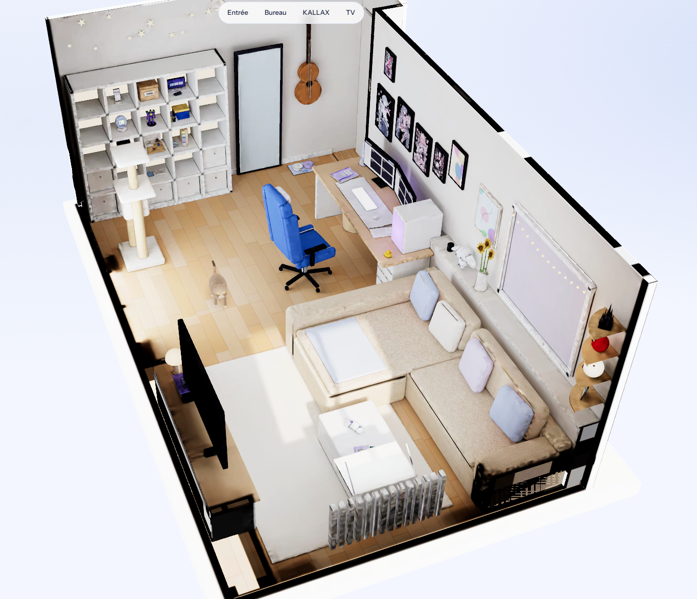
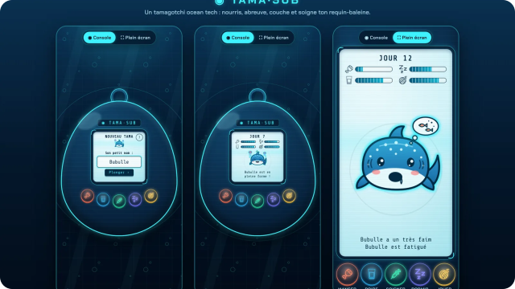
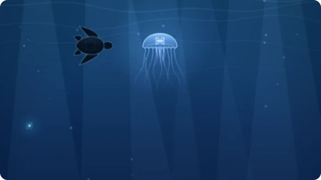
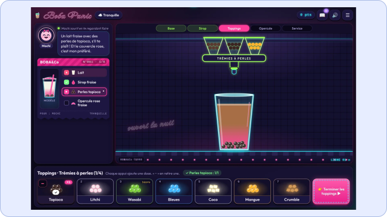
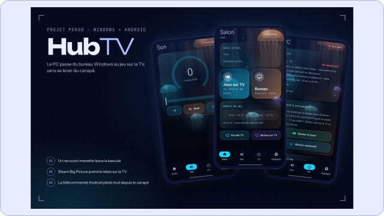

  

I’m Léna, a software engineer based in Lyon, France. In my free time, I make things for the browser for fun: a 3D version of my living room, little games and apps for my own setup.

## Come in, the living room is open

My portfolio is a 3D recreation of my living room. Walk around, click on the objects to discover my work, switch from day to night, and pet Hiki. Built with Angular 22, TypeScript and Three.js, with lighting baked in Blender.

**[Visit the living room](https://nihirii.github.io/portfolio/)** · [Source code](https://github.com/Nihirii/portfolio)

## Side projects

<table>
  <tr>
    <td width="50%" valign="top">
      
      
Look after a little whale shark in an ocean tech console. Feed it, put it to bed and heal it before it’s too late.

      
<b><a href="https://nihirii.github.io/tamagotchi_js/">Play</a></b> · <a href="https://github.com/Nihirii/tamagotchi_js">Code</a>

    </td>
    <td width="50%" valign="top">
      
      
Guide a jellyfish through glowing plankton and dodge sea turtles in a Canvas arcade game.

      
<b><a href="https://nihirii.github.io/Jellyfish/">Play</a></b> · <a href="https://github.com/Nihirii/Jellyfish">Code</a>

    </td>
  </tr>
  <tr>
    <td width="50%" valign="top">
      
      
Run a bubble tea production line, keep up with the rush, or invent questionable drinks in the lab.

      
<b><a href="https://nihirii.github.io/boba-panic/">Play</a></b> · <a href="https://github.com/Nihirii/boba-panic">Code</a>

    </td>
    <td width="50%" valign="top">
      
      
Switch my Windows PC from the desk monitors to the TV, launch Steam Big Picture and control it from my Android phone.

      
<a href="https://nihirii.github.io/portfolio/">View project in portfolio</a>

    </td>
  </tr>
</table>

## In development

| App | What it does |
| --- | --- |
| **Azura** | An offline-first Android app, in development, for logging moods, journaling and following routines. |
| **Routine & Care** | A mobile app for self-care and household routines that adapt to how much energy you have that day. |

## Dojo

A website prototype built as a proposal for the dojo.

[Visit the Dojo website](https://nihirii.github.io/dojo/)

## Design systems and UI

At work, I’m a software engineer on video security products. Among other things, I review front-end changes and document shared components. I maintain the design tokens that feed our Angular UI kit’s Sass theme. [Ganeshka](https://github.com/Nihirii/ganeshka) is a public React and TypeScript project where you can explore UI components in Storybook.

Hiki says hi

  

I’m Léna, a software engineer based in Lyon, France. In my free time, I make things for the browser for fun: a 3D version of my living room, little games and apps for my own setup.

## Come in, the living room is open

My portfolio is a 3D recreation of my living room. Walk around, click on the objects to discover my work, switch from day to night, and pet Hiki. Built with Angular 22, TypeScript and Three.js, with lighting baked in Blender.

**[Visit the living room](https://nihirii.github.io/portfolio/)** · [Source code](https://github.com/Nihirii/portfolio)

## Side projects

<table>
  <tr>
    <td width="50%" valign="top">
      
      
Look after a little whale shark in an ocean tech console. Feed it, put it to bed and heal it before it’s too late.

      
<b><a href="https://nihirii.github.io/tamagotchi_js/">Play</a></b> · <a href="https://github.com/Nihirii/tamagotchi_js">Code</a>

    </td>
    <td width="50%" valign="top">
      
      
Guide a jellyfish through glowing plankton and dodge sea turtles in a Canvas arcade game.

      
<b><a href="https://nihirii.github.io/Jellyfish/">Play</a></b> · <a href="https://github.com/Nihirii/Jellyfish">Code</a>

    </td>
  </tr>
  <tr>
    <td width="50%" valign="top">
      
      
Run a bubble tea production line, keep up with the rush, or invent questionable drinks in the lab.

      
<b><a href="https://nihirii.github.io/boba-panic/">Play</a></b> · <a href="https://github.com/Nihirii/boba-panic">Code</a>

    </td>
    <td width="50%" valign="top">
      
      
Switch my Windows PC from the desk monitors to the TV, launch Steam Big Picture and control it from my Android phone.

      
<a href="https://nihirii.github.io/portfolio/">View project in portfolio</a>

    </td>
  </tr>
</table>

## In development

| App | What it does |
| --- | --- |
| **Azura** | An offline-first Android app, in development, for logging moods, journaling and following routines. |
| **Routine & Care** | A mobile app for self-care and household routines that adapt to how much energy you have that day. |

## Dojo

A website prototype built as a proposal 

[Visit the Dojo website](https://nihirii.github.io/dojo/)

Hiki says hi

