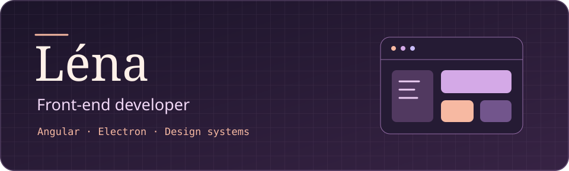

I’m Léna, a front-end developer based in Lyon, France. I build Angular and Electron interfaces, maintain shared UI libraries, and use design tokens to keep Figma and code in sync.

## Professional work

- **UI design** — I design Figma mockups for three video security products.
- **Product front end** — I develop interfaces with Angular and Electron for video security applications.
- **Shared UI kit** — I maintain reusable Angular components, review front-end changes, and document component behavior for other developers.
- **Design system** — I translate Figma designs into implementation and maintain design tokens that feed the Angular UI kit’s Sass theme.

## Featured projects

### 🎮 HubTV · From desk to couch
A controller shortcut switches my Windows PC to the TV, routes the audio, and opens Steam Big Picture. An Android remote can also wake the PC over the local network.  
`Python` `Kotlin` `Jetpack Compose`

### 🌱 Azura · A daily check-in
An Android app in development for recording moods, journaling, and following routines. It’s designed around quick check-ins and local storage.  
`Android` `Offline-first`

## Explore the code

| Project | What you’ll find |
| :--- | :--- |
| 🃏 [League of Stone](https://github.com/Nihirii/Projet_league_of_stone) | A React and Redux card game project where you build a deck of 20 League of Legends champions. |
| 🧩 [Ganeshka](https://github.com/Nihirii/ganeshka) | A React and TypeScript front end with Storybook for exploring UI components. |
| 🐾 Tamagotchi · [JavaScript](https://github.com/Nihirii/tamagotchi_js) / [Python](https://github.com/Nihirii/Tamagotchi_PY) | Two takes on the same virtual pet, one for the browser and one built with Tkinter. |
| ⚙️ [Web services](https://github.com/Nihirii/simonin-lena-webservices) | An Express API with MongoDB integration through Mongoose. |
