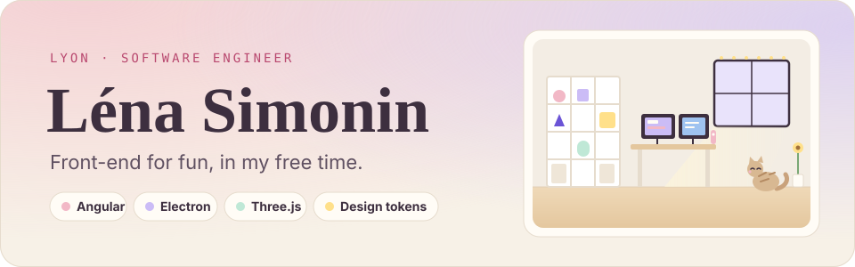
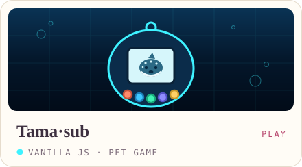
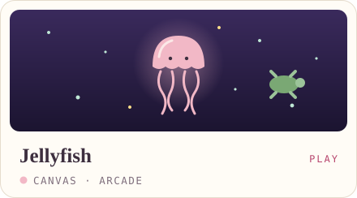
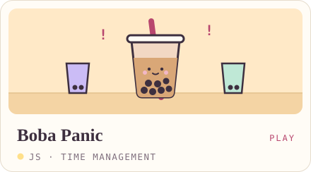
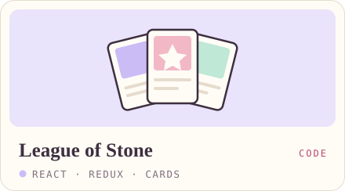

  

I’m Léna, a software engineer based in Lyon, France. In my free time, I make things for the browser for fun: a 3D version of my living room, little games and apps for my own setup.

## 🏠 Come in, the living room is open

My portfolio is a 3D recreation of my living room. Walk around, click on the objects to discover my work, switch from day to night, and pet Hiki. Built with Angular 22, TypeScript and Three.js, with lighting baked in Blender.

**[▶ Visit the living room](https://nihirii.github.io/portfolio/)** · [Source code](https://github.com/Nihirii/portfolio)

## 🎮 Browser games

<table>
  <tr>
    <td width="50%" valign="top">
      
      
Look after a little whale shark in an ocean tech console. Feed it, put it to bed and heal it before it’s too late.

      
<b><a href="https://nihirii.github.io/tamagotchi_js/">▶ Play</a></b> · <a href="https://github.com/Nihirii/tamagotchi_js">Code</a>

    </td>
    <td width="50%" valign="top">
      
      
Guide a jellyfish through glowing plankton and dodge sea turtles in a Canvas arcade game.

      
<b><a href="https://nihirii.github.io/Jellyfish/">▶ Play</a></b> · <a href="https://github.com/Nihirii/Jellyfish">Code</a>

    </td>
  </tr>
  <tr>
    <td width="50%" valign="top">
      
      
Run a bubble tea production line, keep up with the rush, or invent questionable drinks in the lab.

      
<b><a href="https://nihirii.github.io/boba-panic/">▶ Play</a></b> · <a href="https://github.com/Nihirii/boba-panic">Code</a>

    </td>
    <td width="50%" valign="top">
      
      
Build a deck of 20 League of Legends champions in a React and Redux card game.

      
<a href="https://github.com/Nihirii/Projet_league_of_stone">Code</a>

    </td>
  </tr>
</table>

## 🛋️ Personal apps

| | App | What it does |
| :-: | --- | --- |
| 📺 | **HubTV** | Switches my Windows gaming setup from the desk monitors to the TV, changes the audio output and launches Steam Big Picture. An Android remote can also wake the PC over the local network. |
| 🌙 | **Azura** | An offline-first Android app, in development, for logging moods, journaling and following routines. |

## 🎨 Design systems and UI

At work, I’m a software engineer on video security products. Among other things, I review front-end changes and document shared components. I maintain the design tokens that feed our Angular UI kit’s Sass theme. [Ganeshka](https://github.com/Nihirii/ganeshka) is a public React and TypeScript project where you can explore UI components in Storybook.

🐱 Hiki says hi · 🪼 · 🎮 · 🪛

