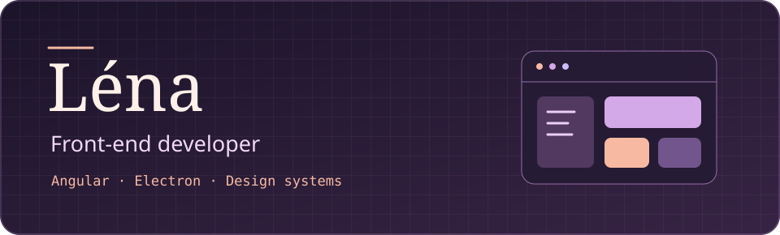

I’m Léna, a front-end developer based in Lyon, France. I build product interfaces with Angular and Electron, maintain a shared Angular UI kit, and connect Figma to code through design tokens.

## [Explore my 3D portfolio](https://nihirii.github.io/portfolio/)

Step into an interactive recreation of my living room and discover my work through the objects in it. Built with Angular 22, TypeScript and Three.js. [Source code](https://github.com/Nihirii/portfolio)

## Browser games

| Project | What you can do | Links |
| --- | --- | --- |
| 🧋 **Boba Panic** | Run a bubble tea production line, keep up with the rush, or invent questionable drinks in the lab. | [Play](https://nihirii.github.io/boba-panic/) · [Code](https://github.com/Nihirii/boba-panic) |
| 🪼 **Jellyfish** | Guide a jellyfish through glowing plankton and dodge sea turtles in a Canvas arcade game. | [Play](https://nihirii.github.io/Jellyfish/) · [Code](https://github.com/Nihirii/Jellyfish) |
| 🐾 **Tamagotchi** | Raise a virtual pet in a pixel-style console, with a full-screen mode for desktop and mobile. | [Play](https://nihirii.github.io/tamagotchi_js/) · [Code](https://github.com/Nihirii/tamagotchi_js) |
| 🃏 **League of Stone** | Build a deck of 20 League of Legends champions in a React and Redux card game. | [Code](https://github.com/Nihirii/Projet_league_of_stone) |

## Personal apps

- **HubTV** switches my Windows gaming setup from desk monitors to the TV, changes the audio output and launches Steam Big Picture. An Android remote can also wake the PC over the local network.
- **Azura** is an offline-first Android app in development for logging moods, journaling and following routines.

## Design systems and UI

At work, I develop interfaces for video security products, review front-end changes and document shared components. I maintain the design tokens that feed our Angular UI kit’s Sass theme. [Ganeshka](https://github.com/Nihirii/ganeshka) is a public React and TypeScript project where you can explore UI components in Storybook.
